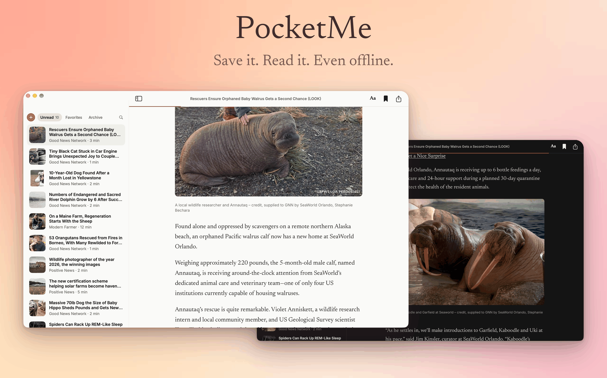

# PocketMe

A calm, warm read-it-later app for Mac and iPhone. Save a link, read it clean, even offline. Syncs with iCloud.



## Download

Get the latest Mac app from [Releases](https://github.com/maxig0d/pocketme/releases/latest). It updates itself.

## Build it yourself

```sh
brew install xcodegen
xcodegen generate
open PocketMe.xcodeproj
```

Needs Xcode 16 and macOS 15. More in [docs/DEVELOPMENT.md](docs/DEVELOPMENT.md).
