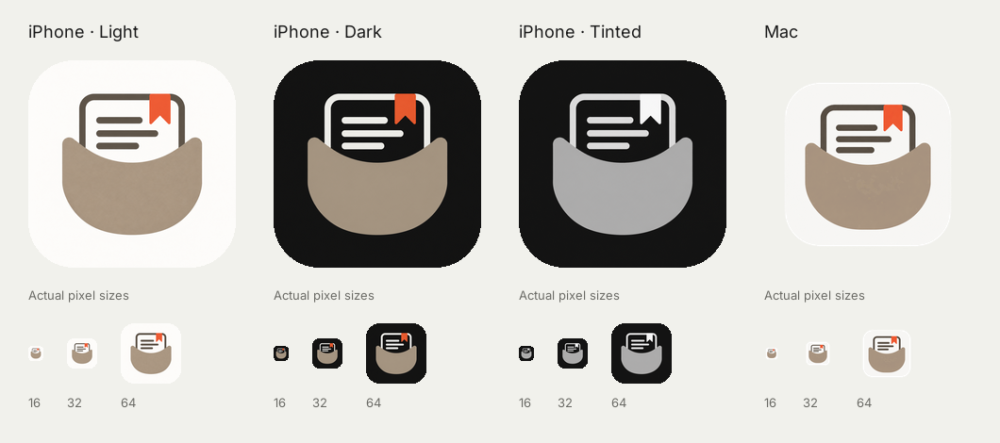

# App icon verification

2026-10-26, Xcode 27.1. Scope: app icon assets and their build configuration only.
No product views or release applet window layout were changed.

- [x] Default, dark and tinted iOS images exported at 1024 × 1024, without alpha.
- [x] All ten standard macOS asset slots exported, with transparent outer margins.
- [x] `AppIcon` selected in the app target's XcodeGen configuration.
- [x] iOS Simulator app and share extension build successfully.
- [x] Native macOS app and share extension build successfully.
- [x] Existing Mac tests pass: 2 tests, 0 failures.
- [x] `Release/dev.sh build` succeeds and refreshes `PocketMe - Dev.app`.
      Its embedded AppIcon.icns matches the verified Mac build byte for byte.
- [x] With Max's explicit approval, rebuilt `PocketMe Release.app` with the same
      pocket artwork; verified the new icon in Finder and opened the applet.
- [x] Built iOS Info.plist selects AppIcon; built Mac Info.plist selects AppIcon,
      and its Resources folder contains AppIcon.icns.
- [x] Visually checked light, dark, tinted and Mac previews at 16, 32 and 64 pixels.
      The pocket silhouette remains visible; the texture largely disappears at
      small sizes. The 16 pixel rendering intentionally prioritizes silhouette
      over article detail.
- [ ] Physical-device Home Screen, actual Dock appearance and system-selected
      tinted rendering checked. This pass uses asset previews and compiled builds.

The previews apply an approximate rounded mask to the iOS art for inspection;
the shipping iOS assets remain square for the system to mask. The tinted preview
shows the neutral source, not a particular user-selected system tint.

Build commands used `-project PocketMe.xcodeproj` explicitly because this local
checkout also contains a second ignored Xcode project.

## UI specification checklist

- [ ] Compared against private mockup artboards at reference screen sizes. Not
      applicable to this icon-only change; the approved icon reference is in chat.
- [x] No system blue introduced.
- [x] No content List styling introduced or changed.
- [x] No product typography changed; preview labels use bundled Inter.
- [x] Icon's light background remains warm paper rather than pure white by design.
- [ ] Row thumbnails 76 × 76, radius 12. Not applicable: no views changed.
- [ ] Screen gutter and row spacing checked. Not applicable: no views changed.
- [ ] Largest Dynamic Type checked. Not applicable: app icons contain no text.
- [x] Dark icon appearance visually checked.
- [x] Light and dark appearance previews saved here. No PR created.

The release applet's Dev and archive scripts regenerate this same project and
therefore use the icon automatically. Its own developer-tool icon also uses
the approved PocketMe artwork, copied into its existing icon build pipeline.
